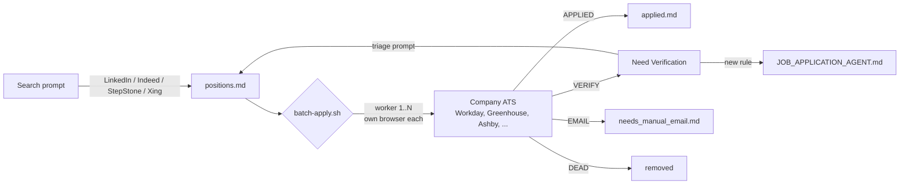

# Job Application AI

An AI agent pipeline that searches for jobs, keeps track of them, and fills out application forms for you. It runs on
[Claude Code](https://claude.com/claude-code) and the [Playwright MCP](https://github.com/microsoft/playwright-mcp)
server.

It is set up for **working-student and junior data / AI / ML roles in Germany**. The role scope, filters, and answers
are plain Markdown, so you can change them for another field or country.

---

## What It Does

- **Searches** LinkedIn, Indeed, StepStone, Xing, and company career pages for new postings in a chosen time window.
  It filters out senior roles, unwanted language requirements, staffing-agency spam, and duplicates.
- **Tracks** every listing in Markdown, in two separate tracks (working student and full-time). Each listing moves
  through *to apply*, *applied*, *need verification*, *manual application required*, or *needs manual email*.
- **Applies** in a real browser. It logs in or creates ATS accounts, fills the forms, uploads the CV and documents,
  writes a cover letter for each role (LaTeX to PDF), gets email OTP codes through the Gmail MCP, and records the
  result.
- **Runs in parallel.** `batch-apply.sh` starts several headless or visible `claude -p` workers, each with its own
  browser profile, and merges their results into the trackers as each one finishes.
- **Learns from failures.** Applications that get stuck are parked with a reason. A triage prompt reviews them, turns
  repeated problems into new rules in the agent instructions, and puts fixable jobs back in the queue.

## How It Works



The agent's behavior is defined in three files:

| File | Role |
|------|------|
| [`profile/candidate.md`](profile/candidate.example.md) | Who you are: contact details, ATS credentials, education, work authorization, standing answers to screening questions |
| [`applications/JOB_APPLICATION_AGENT.md`](applications/JOB_APPLICATION_AGENT.md) | How to work: search methods for each job board, the apply workflow, an ATS playbook (Workday, Greenhouse, Ashby, SuccessFactors, iCIMS, ...), honesty rules, writing style |
| [`applications/USAGE.md`](applications/USAGE.md) | What to run: copy-paste prompts and script commands |

## Repository Structure

```
.
├── profile/
│   └── candidate.example.md         # Copy to candidate.md (gitignored) and fill in
├── resume/
│   ├── cv_4.tex                     # CV source (example: the author's own CV)
│   ├── resume.cls                   # LaTeX class
│   └── build.sh                     # Builds the CV + a hyperlink-free copy for strict ATS scanners
└── applications/
    ├── USAGE.md                     # Prompts and commands
    ├── JOB_APPLICATION_AGENT.md     # Agent instructions
    ├── working student applications/
    │   ├── positions.md             # To apply + parked sections
    │   ├── applied.md               # Submitted applications
    │   └── needs_manual_email.md    # Email-only applications
    ├── full time applications/      # Same structure, FT-prefixed IDs
    ├── notes.md                     # Company notes and search-pass write-ups
    ├── answers/                     # Reusable answers
    ├── cover_letters/               # LaTeX template + build script
    ├── documents/                   # Your upload copies (gitignored)
    ├── reports/                     # Triage reports (gitignored)
    └── scripts/
        ├── batch-apply.sh           # Parallel application orchestrator
        ├── check-listings.sh        # Removes dead listings
        ├── update-counters.sh       # Refreshes tracker counts
        └── linkedin_search/         # Fast LinkedIn guest-API search helpers
```

## Getting Started

### Prerequisites

- [Claude Code](https://docs.claude.com/en/docs/claude-code/overview)
- Node.js (for `npx @playwright/mcp`)
- Python 3 (`pip install -r requirements.txt`)
- A LaTeX distribution with `pdflatex` (TeX Live, MacTeX, or MiKTeX)
- Bash (Git Bash on Windows)
- Optional: the Gmail connector in Claude, so the agent can read verification codes

### Setup

1. **Clone the repo**

   ```bash
   git clone https://github.com/houcem24/job-application-agent.git
   cd job-application-agent
   ```

2. **Add the Playwright MCP server to Claude Code**

   ```bash
   claude mcp add playwright -- npx @playwright/mcp@latest
   ```

3. **Fill in your profile**

   ```bash
   cp profile/candidate.example.md profile/candidate.md
   ```

   Edit `profile/candidate.md`. Use a password only for job portals. The file is gitignored.

4. **Add your CV.** Replace `resume/cv_4.tex` with your own (the one included is an example), then build it:

   ```bash
   ./resume/build.sh
   ```

   This writes `applications/documents/resume.pdf` and `resume_clean.pdf`. Put any other documents (reference letter,
   transcript, ...) in `applications/documents/` using the names in
   [its README](applications/documents/README.md).

5. **Set your cover-letter header.** Fill in the `\candidate...` macros at the top of
   `applications/cover_letters/cover_letter_template.tex`.

6. **Adjust the targeting (optional).** Edit "Target Roles and Interests" in `JOB_APPLICATION_AGENT.md` and the
   prompts in `USAGE.md` to change roles, seniority, location, or language rules.

### Usage

Start Claude Code in `applications/` and paste a prompt from [`USAGE.md`](applications/USAGE.md):

1. **Search:** prompt 1A or 1B fills `positions.md` with new, verified, deduplicated listings.
2. **Apply:** apply interactively with prompt 3, or run the batch:

   ```bash
   cd applications
   ./scripts/check-listings.sh                  # remove dead links first
   ./scripts/batch-apply.sh --dry-run           # preview the queue
   ./scripts/batch-apply.sh --max 10 --parallel 3
   ```

3. **Triage:** prompt 2 clears the Need Verification queue and writes a plain-English report.

## Design Principles

- **Honest by default.** The agent never claims a language level, degree, experience, or residence the candidate does
  not have. Hard mismatches are parked or dropped, not answered around.
- **Every job ends in a known state.** Each opened listing ends as Applied, Dead, Need Verification, or Needs Manual
  Email. Nothing is dropped silently.
- **No duplicates.** `applied.md` is checked before every application and updated right after each one, and every
  search pass ends with a duplicate sweep.
- **Employer sites first.** Applications are not submitted through LinkedIn. Listings are resolved to the employer's
  own ATS.
- **No CAPTCHA bypassing.** Real CAPTCHA challenges go to a human.

## Disclaimer

This is a personal productivity tool. You are responsible for every application submitted in your name. Review your
profile and answers carefully, follow each job board's terms of service, and keep parallelism reasonable. Automated
use of some job boards may be restricted by their terms.

## License

[MIT](LICENSE)
